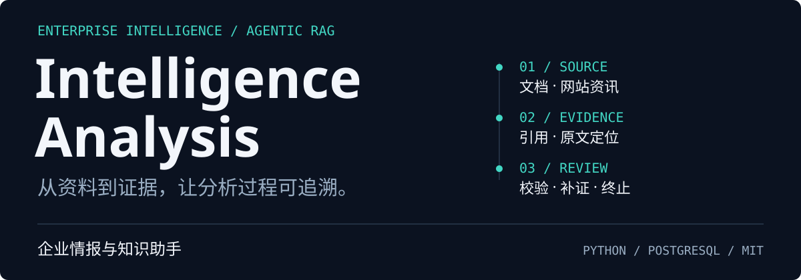
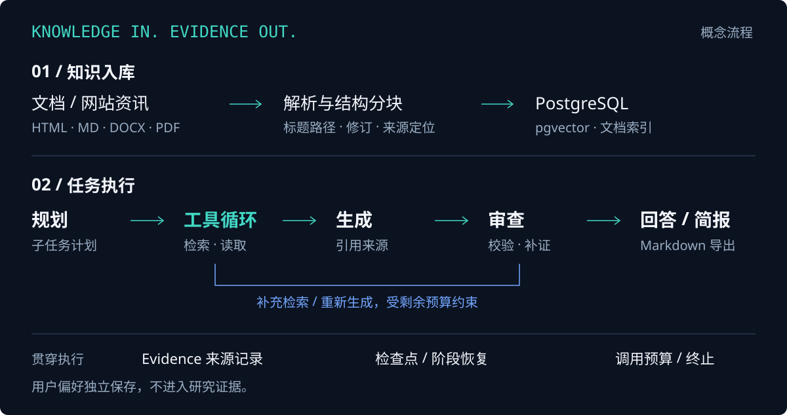

<picture>
  <source media="(max-width: 600px)" srcset="./assets/readme/hero-mobile.svg">
  
</picture>

# 企业情报与知识助手

将内部文档与网站资讯统一纳入知识库，通过 **Agentic RAG** 完成资料检索、来源核查、多轮问答与情报简报导出。面向产品与市场动态、公告法规查询、内部知识问答等需要查阅多份来源的场景。

**Python 3.13+ · FastAPI · PostgreSQL / pgvector · MIT**

[任务示例](#从一个问题开始) · [工作原理](#工作原理) · [本地运行](#本地运行) · [评测与观测](#评测与观测) · [功能边界](#功能边界)

## 从一个问题开始

> 示例问题：根据已入库资料，整理近期产品公告，比较主要变化，并列出引用来源。

通过 `POST /api/v1/agent/tasks` 发起任务。返回内容除回答外，还包含计划、证据、审查与预算，便于检查分析过程。

**返回结构示意**（字段来自 [AgentTaskRead](backend/app/schemas/agent.py)，不是实际任务输出）：

```text
AgentTaskRead
├── answer                回答正文
├── plan / evidence       子任务计划与可定位的来源
├── claims / review       断言、引用与审查结论
├── budget / trace        调用消耗与阶段记录
└── status / recovery     任务状态及是否允许恢复
```

审查通过的任务可导出带引用的 **Markdown 简报**。证据不足或预算耗尽时，返回相应状态；用户偏好用于个性化，独立于研究证据。

## 工作原理

<picture>
  <source media="(max-width: 600px)" srcset="./assets/readme/workflow-mobile.svg">
  
</picture>

### RAG：检索结果能定位回原文

HTML、Markdown、DOCX 与文本型 PDF 先转为统一文档块，再按结构与递归字符规则分块，保留标题路径、原文偏移和修订信息。新版索引采用 `documents → revisions → chunks`，仅在处理成功后激活新修订。

检索基于 **BGE-m3 + pgvector**，可选稠密 / 稀疏召回、RRF 融合与 BGE-reranker 重排。Ollama 嵌入适配提供稠密向量；混合检索需切换到 FlagEmbedding 并重建索引。`legacy` 入口继续兼容已有文章片段。

### Agent：让工具循环处于任务流程之内

**LangGraph** 编排规划、执行、生成、审查与终止；**Deep Agents** 承担每个子任务的模型—工具调用循环。外层管理 Evidence 来源记录、补证策略与共享预算，内层调用知识检索、来源读取、联网搜索和网页提取等工具。

- **上下文管理**：完整问答轮次选择、阈值摘要、长工具结果卸载与文件按需读取；历史答案不作为事实证据。
- **执行控制**：工具参数校验、调用与时间预算、任务目录内文件访问；不启用通用子 Agent 或 shell 工具。
- **状态恢复**：PostgreSQL 保存任务与检查点，按安全阶段暂停和恢复；通过 `recovery.can_resume` 判断能否继续。
- **长期记忆**：Mem0 保存明确的用户偏好，按用户隔离、跨会话召回；任务 notes 与用户 profile 分开管理。

### 观测与评测：过程可查，指标分开统计

**Langfuse** 跟踪执行阶段、模型消耗与实验评分；检索 Recall / MRR / nDCG、回答质量和 Harness 工程行为由相应脚本分别评测。固定夹具通过与真实业务成功分别统计，不混用结果口径。

<details>
<summary>查看代码结构与技术组成</summary>

```text
backend/
  app/
    agents/             # 任务图、执行器、上下文、记忆、检查点与证据
    api/routes/v1/      # 用户、文章、RAG 与 Agent API
    services/
      crawler/          # 配置、采集、增量调度与落库
      rag/              # 解析、分块、嵌入、入库与检索
      agent.py          # 会话和任务生命周期
      artifact.py       # 简报导出
    repository/         # 数据访问
    db/models/          # 业务数据模型
    core/               # 配置、鉴权、日志与观测
  alembic/              # 数据库迁移
  eval/                 # 检索、Agent 与端到端评测
  tests/                # 后端自动化测试
frontend/               # 用户与资料管理界面
config/                 # 采集站点及选择器配置
```

后端按 **Routes → Services → Repositories** 分层，使用 FastAPI、Pydantic v2、SQLAlchemy、psycopg 与 Alembic。前端使用 React、Vite、TanStack Router。采集支持 HTTP、浏览器及 JSON API；解析使用 BeautifulSoup、PyMuPDF、python-docx 与 markdown-it-py。

聊天模型支持 OpenAI 兼容接口、Ollama 与 Bedrock 适配。以下以 DeepSeek 聊天 API、Ollama 本地嵌入为例。依赖版本见 [backend/pyproject.toml](backend/pyproject.toml) 与 `uv.lock`。

</details>

## 本地运行


### 1. 准备依赖与配置

需要 Python 3.13+、uv、安装 pgvector 的 PostgreSQL，以及用于本地嵌入的 Ollama。浏览器抓取模式另需 Chrome/Chromium；运行前端时需要 Bun。

以下命令使用 PowerShell，从仓库根目录执行。配置文件仅在首次运行时复制，已有文件请保留。

```powershell
if (-not (Test-Path .env)) { Copy-Item .env.example .env }
if (-not (Test-Path backend/.env)) { Copy-Item backend/.env.example backend/.env }
uv sync --frozen
```

在根目录 `.env` 中配置数据库、项目名称、`SECRET_KEY`、`FIRST_SUPERUSER` 和 `FIRST_SUPERUSER_PASSWORD`，替换模板中的 `changethis`。管理员邮箱可使用自己的本地测试账号。

在 `backend/.env` 中配置模型和检索。该文件覆盖根目录中的同名配置：

```dotenv
LLM_PROVIDER=openai
OPENAI_BASE_URL=https://api.deepseek.com
OPENAI_MODEL=deepseek-flash
OPENAI_API_KEY=your-provider-api-key

RAG_EMBED_PROVIDER=ollama
RAG_OLLAMA_BASE_URL=http://127.0.0.1:11434
RAG_OLLAMA_EMBED_MODEL=bge-m3
OLLAMA_BASE_URL=http://127.0.0.1:11434

# 新建知识库使用 documents；已有旧索引不要直接当作已完成迁移。
RAG_INDEX_SOURCE=documents
RAG_HYBRID_ENABLED=false
RAG_RERANK_ENABLED=false

LANGFUSE_ENABLED=false
LANGSMITH_TRACING=false
```

`OPENAI_API_KEY` 在此处填写所选服务商的密钥。聊天模型与嵌入模型分别配置；仅进行知识库检索时不会调用聊天模型。

<details>
<summary>可选：混合检索与重排配置</summary>

**嵌入与混合检索：** Ollama 适配仅提供稠密向量。启用稀疏混合召回时，需要将 `RAG_EMBED_PROVIDER` 改为 `flagembedding`，重新构建相应索引后再开启 `RAG_HYBRID_ENABLED`。重排由 `RAG_RERANK_ENABLED` 独立控制。当前向量列为 1024 维，更换嵌入模型时需核对维度及索引兼容性。

</details>

### 2. 初始化数据库与模型

可以使用已有 PostgreSQL；也可以在根目录执行 `docker compose up -d db`，使用仓库配置的 pgvector 数据库镜像。连接参数须与根目录 `.env` 一致。

```powershell
ollama pull bge-m3

cd backend
uv run alembic upgrade head
uv run python -m bootstrap.initial_data
uv run python -c "from app.db.session import run_compatible_async; from app.agents.checkpoints import setup_checkpoints; run_compatible_async(setup_checkpoints())"
```

Alembic 管理业务表；最后一条命令单独初始化 `agent_checkpoints` schema 及 LangGraph 检查点表。数据库账号需有相应建表权限。

### 3. 启动后端

从 `backend/` 启动，以确保相对路径下的配置文件被正确读取：

```powershell
uv run uvicorn app.main:app --reload --port 8848
```

- API 文档：<http://localhost:8848/docs>
- 健康检查：<http://localhost:8848/api/v1/utils/health-check/>

Windows 下请保留 `--reload`，或使用 Docker / WSL；项目的异步 PostgreSQL 驱动不能运行在默认 Proactor 事件循环上。CLI 已通过项目的兼容运行器处理这一差异。

<details>
<summary>可选：启动前端管理界面</summary>

另开终端，从仓库根目录进入 `frontend/`，将 `frontend/.env` 中的 `VITE_API_URL` 设置为 `http://localhost:8848`，然后执行：

```powershell
cd frontend
bun install
bun run dev
```

现有前端提供账号、文章和配置等管理页面；Agent 的完整生命周期操作以 API 为主。

</details>

## 导入资料与发起分析


### 文档入库

以下命令均在 `backend/` 执行。准备一份文档，用实际路径替换 `./sample.md`；同一来源更新时保持 `source-key` 不变：

```powershell
uv run python -m app.services.rag import ./sample.md --source-key sample-document
uv run python -m app.services.rag query "这份资料的主要内容是什么？" --top-k 5
```

导入结果返回文档、修订及处理状态。可使用 `status --document-id <id>` 查询，使用 `resume --revision-id <id>` 继续失败修订，使用 `read --document-id <id>` 按范围读取原文。新旧版本的处理配置变化时，应重新导入生成修订。

### 采集网站资讯

在 `config/monitor_sites.json` 配置自己的站点，按需在 `config/list_selectors.json` 配置选择器或 JSON API 规则：

```powershell
uv run python -m app.services.crawler --site "example-site" --limit 3
uv run python -m app.services.rag --index-source documents index-articles
```

将 `example-site` 替换为配置中的站点名称。第一条命令采集并写入文章，第二条将文章同步到新版文档索引。`--scrape-only` 可只检查采集结果，不写库；此时不会确认数据库入库进度。配置和运行日志也可通过 `MONITOR_DATA_DIR` 放在仓库之外。

### Agent API

在 Swagger 中通过 `/api/v1/users/login/access-token` 登录并授权，然后调用 `POST /api/v1/agent/tasks`：

```json
{
  "question": "请根据已入库资料整理近期产品公告，并列出引用来源。"
}
```

返回值包含 `task_id`、`conversation_id`、计划、证据、回答、审查结果和预算。后续提问携带同一个 `conversation_id` 即可延续会话。

| 接口 | 用途 |
| --- | --- |
| `POST /api/v1/rag/query` | 仅检索资料，返回片段和来源，不生成回答 |
| `POST /api/v1/agent/tasks` | 执行分析任务 |
| `GET /api/v1/agent/tasks/{task_id}` | 查看任务及恢复状态 |
| `POST /api/v1/agent/tasks/{task_id}/pause` | 请求在安全阶段暂停 |
| `POST /api/v1/agent/tasks/{task_id}/resume` | 恢复允许继续的任务 |
| `POST /api/v1/agent/tasks/{task_id}/abandon` | 放弃任务 |
| `POST /api/v1/agent/tasks/{task_id}/artifacts` | 导出审查通过的任务简报 |
| `POST /api/v1/agent/profile` | 保存明确的用户偏好 |

任务、会话、记忆与产物接口需要登录，并检查所属用户。外部搜索工具另需配置 `TAVILY_API_KEY`；不配置时应以知识库内的证据范围为准。

## 评测与观测


在 `backend/` 执行：

```powershell
uv run pytest
uv run ruff check app tests eval
uv run python -m eval.run_prototype_eval
```

单元测试拦截真实聊天模型调用。原型评测使用固定夹具、默认只保存本地结果，不调用真实模型或访问业务数据库。

| 评测方向 | 入口与内容 |
| --- | --- |
| 检索质量 | `eval/retrieval_eval.py`、`eval/metrics.py`：Recall@k、MRR、nDCG；区分片段与文档排名口径 |
| 回答质量 | `eval/faithfulness_eval.py`、`eval/relevance_eval.py`：忠实度与相关性评测 |
| Harness 工程行为 | `eval/run_prototype_eval.py`：固定夹具验证引用、工具错误、上下文及预算等行为 |
| API 端到端 | `eval/run_e2e_eval.py`、`eval/run_langfuse_eval.py`：认证 API、任务生命周期及结果评分 |
| 公开数据集 | `eval/datasets/prepare_scifact.py`、`eval/run_scifact.py`：SciFact 数据准备与独立检索实验；运行前需核对脚本中的固定配置 |

接入 Langfuse 时，在 `backend/.env` 填写 `LANGFUSE_PUBLIC_KEY`、`LANGFUSE_SECRET_KEY`、`LANGFUSE_BASE_URL` 并开启 `LANGFUSE_ENABLED`。普通 API 观测仅导出白名单元数据；详细实验追踪由显式实验上下文开启。

工程场景通过率、检索指标与真实业务回答质量分别统计。真实模型实验需明确启用付费调用并记录请求预算；实验上传需显式使用发布选项。本地报告重传不应重新执行业务任务。

## 功能边界


- 文本型 PDF 可直接解析；扫描件需要先做 OCR。旧版 `.doc`、合并单元格等复杂内容不保证直接支持。
- 会话、知识索引、任务及检查点存储在 PostgreSQL。任务 notes、卸载结果位于 `backend/.agent_data/`，Mem0 的审计历史仍使用本地 SQLite；部署时需持久化该目录。
- 运行中的任务控制含进程内状态，当前不提供分布式任务队列或跨实例运行时接管。
- 默认 Agent 预算为 12 次模型调用、12 次工具调用、180 秒及最多 2 次审查重试。预算终止与任务成功是不同结果，具体状态通过 API 返回。
- `.env`、模型权重、原始资料、任务记录及评测输出属于本地运行数据，不随示例配置分发。仓库不附带私人知识库或可直接使用的服务密钥。

## License

[MIT License](LICENSE)。
